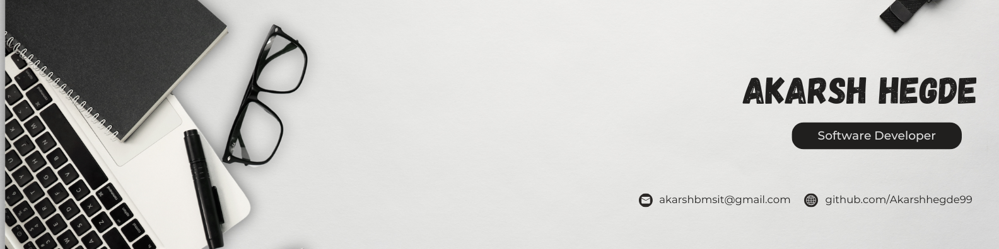

<!-- 🎨 Banner -->

  

<!-- 🔥 Typing Animation -->

  

  <b>📍 Bengaluru, India &nbsp;|&nbsp; 🎓 BMSIT '26 &nbsp;|&nbsp; 💼 Associate Consultant @ Oracle OFSS</b>
   
  <i>Building resilient backend microservices, scalable banking architectures & intelligent AI-powered solutions.</i>

<!-- 🌐 Connect with Me -->

  
  
  
  
  

---

## 🧠 About Me

* 💼 **Associate Consultant** at **Oracle Financial Services Software (OFSS)**, building high-performance backend systems for banking.
* 🎓 **B.E. in Information Science and Engineering** from **BMS Institute of Technology and Management** (CGPA: 8.96/10).
* ☕ Core focus on **Java, Spring Boot, REST APIs, and Microservices Architecture**.
* 💻 Experienced in full-stack development with **React, Spring Boot, MySQL, and Oracle DB**.
* 🤖 Passionate about Machine Learning & AI systems — Selected for **Amazon ML Summer School 2025** (Top 5% nationwide).
* 💡 Strong advocate for **clean architecture, resilient service design, and real-world problem solving**.
* 🏆 **Community & Leadership:** Ex-Intern @ IEEE | Treasurer @ Coding Club BMSIT | Hackathon Finalist.

---

## 💼 Work Experience

### 🏢 **Oracle Financial Services Software**
*Associate Consultant | Bengaluru, India | Aug 2026 – Present*
- Developing and optimizing backend services for scalable, high-performance banking solutions.
- Building banking site services using **Java, Spring Boot, REST APIs, and microservices architecture**.
- Enhancing transaction processing reliability, service isolation, and enterprise system performance.

### 💼 **Margros Pvt Ltd**
*Software Engineering Intern | Bengaluru, India | Jan 2026 – Apr 2026*
- Built a full-stack **Cricket Screening Pass Entry and Menu Card Landing Page** using **React, Spring Boot, and MySQL**.
- Assisted in backend development, debugging, testing, and deployment for restaurant solutions.
- Collaborated with developers using **Git and Agile workflow** while delivering production-ready features.

---

## 🚀 Featured Projects

### 🏦 [OPay – NetBanking World]([https://github.com/Akarshhegde99](https://github.com/VarshitNg15/OPay-NetBankingWorld))
> **Tech Stack:** `Java` `Spring Boot` `Microservices` `Oracle DB` `Apache Kafka` `Redis` `Oracle JET (OJET)` `JWT` `Prometheus` `Grafana`
- Developed a comprehensive full-stack digital banking platform using **Spring Boot microservices** and **Oracle JET** with JWT-based authentication and secure API gateway routing.
- Implemented independent services for authentication, user management, account operations, transaction processing, and automated notifications using **Oracle Database** and **Kafka**.
- Integrated **Redis-based rate limiting**, **Eureka service discovery**, and **Prometheus-Grafana monitoring** for high-throughput scalability and system observability.

---

### 🏏 [DigiStadium]([https://github.com/Akarshhegde99](https://github.com/Akarshhegde99/Harveys_Cafe))
> **Tech Stack:** `React` `Spring Boot` `MySQL` `REST APIs` `Tailwind CSS`
- Developed **Harvey’s Cafe IPL Table Booking System** with dedicated, role-based User and Admin portals.
- Integrated secure booking, **QR-based ticket generation**, and real-time reservation management.
- Implemented dynamic IPL match updates and a streamlined table booking experience.

---

### 📊 [SortInsight: Visualizing Algorithms]([https://github.com/Akarshhegde99](https://github.com/Akarshhegde99/Sorting-Insight))
> **Tech Stack:** `JavaScript` `Algorithms` `Bootstrap` `HTML5` `CSS3`
- Built an interactive web application to visualize popular sorting algorithms in real time with step-by-step animations.
- Implemented **Merge, Quick, Bubble, Selection, and Insertion Sort** with detailed algorithmic metrics.
- Developed an intuitive, responsive interface using **HTML, CSS, JavaScript, and Bootstrap** for interactive algorithm learning.

---

## ⚡ Tech Stack

### 👨‍💻 Programming Languages

  
  
  
  
  
  
  

### ☕ Backend & Architecture

  
  
  
  
  
  
  
  
  

### 🌐 Frontend Development

  
  
  
  
  

### 🤖 AI / Machine Learning

  
  
  
  
  

### ☁️ Tools & Platforms

  
  
  
  
  
  
  
  
  
  

### 🧩 Core Competencies
`Object-Oriented Programming (OOP)` &nbsp;•&nbsp; `Data Structures & Algorithms (DSA)` &nbsp;•&nbsp; `Microservices Architecture` &nbsp;•&nbsp; `Computer Science Fundamentals` &nbsp;•&nbsp; `Version Control (Git)`

---

## 🎓 Education

* **BMS Institute of Technology and Management, Bengaluru** *(2022 – 2026)*  
  **Bachelor of Engineering (B.E.)** in *Information Science and Engineering*  
  🎯 **CGPA: 8.96 / 10**

* **Viveka PU College, Kota, Udupi** *(2020 – 2022)*  
  **Karnataka Pre-University Certificate** (PCMB)  
  🎯 **Percentage: 96.00%**

---

## 🏆 Achievements & Honors

* 🌟 **Amazon ML Summer School 2025** — Selected among the **Top 5%** of applicants nationwide.
* 🏅 **0X Hackday Hackathon, Pondicherry** — **Top 5 Finalist** for innovative technical prototyping.
* 🚀 **DevSprint Hackathon** — Finalist for building and deploying a functional web portal for Government High School, Rajanukunte.
* 🎖️ **Best Outgoing Student Award (2020)** — Awarded at Government High School, Halady.

---

## 📊 GitHub Analytics & Activity

  
  

  

  

---

## 🎯 Current Focus

* ☕ **Enterprise Banking Systems:** Building and optimizing resilient, high-throughput microservices at Oracle OFSS.
* 🧩 **Advanced Microservices Patterns:** Event-driven architecture, distributed caching with Redis, and Kafka streaming.
* 🔗 **AI & Intelligent Systems:** Integrating machine learning models with enterprise backend infrastructure.

---

  

